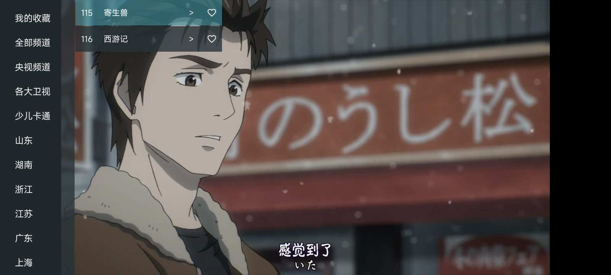
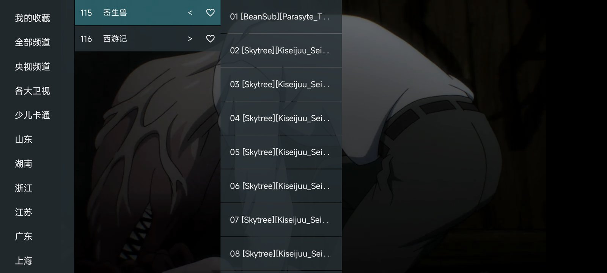
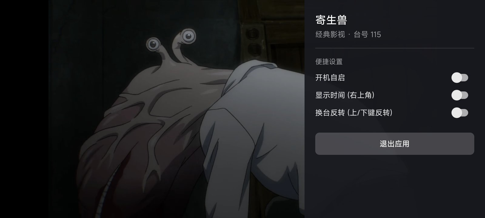

# 我的电视 · 本地版

基于 [my-tv-webview](https://github.com/zwc456baby/my-tv-webview) 的个人定制版：保留原版的央视 / 卫视网页直播，并加入本地剧集媒体库、三级选集、单记录续播和手机 / 遥控器快进快退等。


## 功能

### 直播

- 央视、各大卫视、地方台、少儿卡通等分组，频道列表自动更新，支持自定义源（见 `source` 目录）
- 每个频道支持多条播放线路（央视频 / 央视网）：网页加载失败会自动切换到下一条线路，并记住可用的线路，下次直接播放
- 收藏频道：点频道行右侧红心加入「我的收藏」
- 换台：遥控器上 / 下键、数字键；可在设置中开启换台反转

### 本地媒体库

- 自动扫描 `/storage/emulated/0/我的电视本地资源库/`（也支持 TF 卡、U 盘），按目录生成分组与频道
- 支持 mp4、mkv、avi、flv、ts、mov、rmvb、wmv、m4v、webm、iso
- 目录结构：

```
我的电视本地资源库/
└── 经典影视/                          # 分组
    └── 寄生兽/                        # 频道
        ├── [Skytree][Kiseijuu_Sei_no_Kakuritsu][01][GB_JP][720P].mp4
        ├── [Skytree][Kiseijuu_Sei_no_Kakuritsu][02][GB_JP][720P].mp4
        └── ...
```

### 手机手势

| 操作 | 功能 |
| --- | --- |
| 点按屏幕左侧 70% | 打开菜单 |
| 点按屏幕右侧 | 打开便捷设置 |
| 双击屏幕 | 开关菜单 |
| 左 1/3 区域上下滑 | 调节亮度 |
| 右 1/3 区域上下滑 | 调节音量 |
| 横向滑动（本地视频） | 快进 / 快退 |

### 遥控器

| 按键 | 功能 |
| --- | --- |
| 上 / 下 | 换台 |
| 中键 / 确认 | 打开频道菜单 |
| 左键 | 节目单（菜单展开时收起选集列） |
| 右键 | 便捷设置（菜单中展开选集列） |
| 长按左 / 右 | 本地视频快退 / 快进 |
| 菜单键 / 设置键 | 便捷设置 |
| 数字键 | 数字换台 |

### 便捷设置

开机自启、右上角显示时间、换台反转、退出应用；直播频道可在此切换播放线路。

## 截图

| 频道菜单 | 三级选集 |
| --- | --- |
|  |  |

| 便捷设置 |
| --- |
|  |

## 构建

要求 JDK 17、Android SDK 36：

```bash
./gradlew assembleDebug
```

产物：`app/build/outputs/apk/debug/我的电视 本地版.apk`

## 发布

推送 `v*` 标签会由 GitHub Actions 自动构建 APK 并创建 Release：

```bash
git tag v1.0.0
git push origin v1.0.0
```

构建使用仓库内 `keystore/debug.keystore` 固定签名，后续版本可直接覆盖安装。

## 声明

- 本应用仅嵌套展示电视台公开的直播页面，所有内容来自原网站，版权归原网站所有。
- 本应用不提供任何视频资源，不储存、不转发，仅用于学习研究用途。
- 本项目基于 [my-tv-webview](https://github.com/zwc456baby/my-tv-webview)，参考 [my-tv-0](https://github.com/lizongying/my-tv-0) 与 [WebViewTvLive](https://github.com/hxh19950701/WebViewTvLive)。
- [MIT License](./LICENSE)
